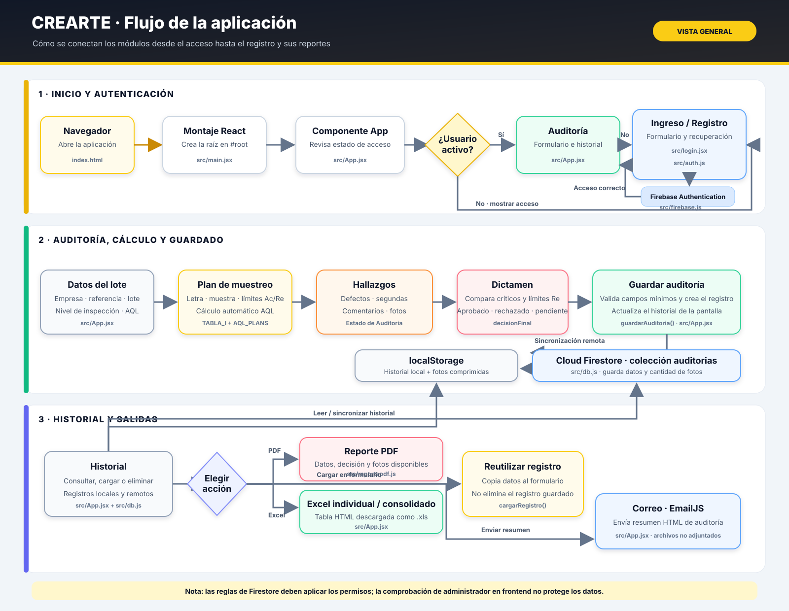

# Diagrama gráfico de Crearte

[Abrir o descargar el diagrama en formato SVG](./DIAGRAMA_FLUJO.svg)

## Cómo leerlo

El gráfico está organizado en tres etapas:

1. **Inicio y autenticación:** el navegador carga React; `App` decide si mostrar el acceso o el módulo de auditoría. El login se comunica con Firebase Authentication.
2. **Auditoría, cálculo y guardado:** se capturan los datos del lote, se calcula el plan AQL, se registran hallazgos y se guarda primero en el navegador; después se sincroniza con Firestore.
3. **Historial y salidas:** desde los registros se puede revisar o reutilizar una auditoría, eliminarla y generar reportes PDF o Excel, o enviar el resumen por correo.

Los nombres de archivo bajo cada bloque indican dónde está implementada esa parte. El gráfico también señala que las fotos se conservan localmente, que los archivos Excel son tablas HTML con extensión `.xls` y que los archivos seleccionados en el modal de correo no se adjuntan actualmente a la solicitud.
